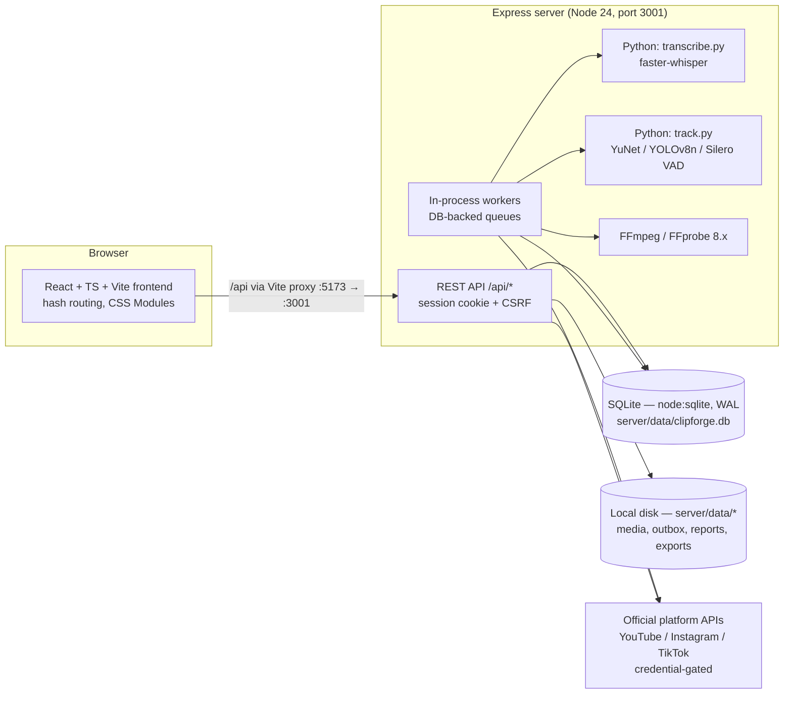

# CLIPFORGE — Architecture

This document describes the system **as implemented**. Where the code
documents a production path that does not run here (PostgreSQL,
BullMQ/Redis, object storage), that is said explicitly.

## System diagram



There is no separate queue server, cache server or database server.
One Node process hosts the API **and** all workers.

## Frontend structure (`src/`)

| Path | Responsibility |
| --- | --- |
| `src/main.tsx` | Entry point; mounts `App`. |
| `src/App.tsx` | Lightweight hash router (no router dependency). Landing at `#`/no hash; auth routes (`login`, `signup`, `forgot-password`, `reset-password`, `verify-email`, `accept-invitation`); protected workspace routes inside `AppShell`; sub-routes `studio/create`, `studio/enhance`, `projects/<id>`, `projects/<id>/editor`, `projects/<id>/exports`. |
| `src/pages/` | Route pages: `HomePage` (landing), `StudioPage`, `ProjectsPage`, `ClipsPage`, `EditorPage`, `ExportsPage`, `TemplatesPage`, `PublishingPage` (calendar/queue variants), `AnalyticsPage`, `SettingsPage`, `AdminPage`, `PlaceholderPage`; plus `pages/auth/` (six auth pages) and `pages/studio/` (`CreateShortsPage`, `EnhanceVideoPage`, `ProjectDetailPage`, `VideoEditorPage`). |
| `src/components/` | Shared UI (`AppShell`, `Button`, `Input`, `Modal`, `Tabs`, `Logo`, states, …) plus grouped components: `landing/` (incl. `MediaPlaceholder`), `editor/` (timeline, preview canvas, caption studio, reframe/enhance panels), `studio/`, `analytics/Charts`. |
| `src/services/` | Typed API clients, one per backend area: `api.ts` (base), `auth.ts`, `projects.ts`, `analysis.ts`, `editor.ts`, `captions.ts`, `tracking.ts`, `phase8.ts`, `export.ts`, `publishing.ts`, `analytics.ts`, `account.ts`, `admin.ts`. |
| `src/features/` | Feature homes: `auth/` (`AuthContext`), `analytics/`, `clips/`, `editor/`, `projects/`, `publishing/`, `studio/`, `video-input/`. |
| `src/config/landingAssets.ts` | Central landing-media slot map. Every slot is currently an **empty placeholder** by owner instruction; no landing media is wired. |
| `src/styles/tokens.css` | The only place brand colours are defined (`--midnight #030407`, `--cobalt #1558C9`, `--lime #D4FF24`). |
| `src/types/` | Shared TypeScript types. |

The frontend holds **no secrets** and never treats its own state as
authorization — the server enforces everything.

## Backend module map (`server/src/`)

One line per file, from its actual responsibility in the code:

| File | Responsibility |
| --- | --- |
| `index.ts` | Boot: runs migrations via `getDb()`, starts all eight workers, creates the app, listens on `config.port` (3001). |
| `app.ts` | Express app factory: security headers, dev CORS, raw-body capture for webhooks, CSRF double-submit middleware, rate limits, the `/api/auth` router (register/login/logout/verify/reset/MFA gate), the workspace-role guard, mounting of every phase router, `/api/health`, safe error handler. |
| `config.ts` | All environment configuration; provider-configuration gates (`publishingProviderStatus`, `paymentsStatus`, `isAdminEmail`, `emailConfigured`, …). No hard-coded secrets. |
| `db.ts` | SQLite layer (`node:sqlite`): migrations v1–v15 (idempotent, run on boot; final `PRAGMA user_version = 15`; v15 widens the `source_assets.source_type` and `phase8_jobs.kind` CHECKs for URL import), row types, `getDb()`/`closeDb()`. |
| `email.ts` | Email adapter: nodemailer SMTP when `SMTP_HOST` is set, otherwise JSON files in `server/data/outbox/`. Builds verification/reset/invitation message bodies. |
| `studio.ts` | Phase 3: projects CRUD, upload sessions, multipart upload → FFprobe verification, source streaming/thumbnails, YouTube URL validation (metadata only — the validator itself never downloads media; downloading a pasted URL is `urlImport.ts`). |
| `urlImport.ts` | URL import: `POST /projects/:id/url-import` + the `URL_IMPORT` phase8-job processor — SSRF guard, yt-dlp download (best MP4 ≤1080p, `MAX_UPLOAD_MB` cap), upload-identical FFprobe validation/thumbnail, provenance on the media meta/licence tables. Env-gated (`YTDLP_BIN`, `URL_IMPORT_ENABLED`, `URL_IMPORT_ALLOW_PRIVATE`). |
| `media.ts` | FFprobe/FFmpeg inspection helpers: the only source of media metadata; allowed extensions `.mp4/.mov/.webm`. |
| `stt.ts` | Speech-to-text adapters: local faster-whisper (spawns `scripts/transcribe.py`) and OpenAI-compatible HTTP; configuration verification; no diarization. |
| `analysis.ts` | Phase 4: clip-detection jobs and worker — audio extraction, transcription, sentence/pause/scene analysis, measurable ranking, verified preview cuts; transcripts and candidates APIs. |
| `editor.ts` | Phase 5: editor documents (tracks/items/captions/overrides), snapshot-based undo/redo operations, named versions, project media, and the render worker + render-job APIs. |
| `captionStyle.ts` | Leaf module: the caption-style model (Zod) shared by editor and Captions Studio. Note: `lineSpacing` is preview-only — libass cannot change line height in renders. |
| `captions.ts` | Phase 6: caption templates (10 built-ins in code + user templates), caption tracks/variants, subtitle import/export (SRT/VTT/ASS), translation jobs (provider-gated), brand assets and brand kits. |
| `tracking.ts` | Phase 7: tracking jobs and worker (spawns `scripts/track.py`), anonymous subjects, active-speaker association, reframe configurations, crop keyframes, split-screen layouts, reframe renders. |
| `broll.ts` | Phase 8 routes + worker: media library (union view over existing asset tables), transcript-driven B-roll recommendations/placements, enhancement/background/generation jobs, effect presets. Stock/generation/background adapters are stubs (`implemented: false`). |
| `enhance.ts` | Phase 8 filter-chain builder: one FFmpeg filter-chain builder shared by preview jobs, asset jobs and the render pipeline. Standard filters only — never labelled "AI". |
| `export.ts` | Phase 9: Export Studio — presets, preflight, export jobs on the shared `render_jobs` table, QC gate, queue controls, history, ZIP bundle worker. |
| `providers.ts` | Phase 10: official platform adapters (YouTube Data API v3, Instagram via Instagram Login, TikTok Content Posting API), shared provider HTTP + error classification. |
| `publishing.ts` | Phase 10: connected accounts, OAuth flows, publishing jobs (validate → approve → submit/schedule), scheduler/status worker, calendar/queue/history, webhooks, post metrics. |
| `tokenCrypto.ts` | AES-256-GCM encryption of OAuth tokens at rest; key from `TOKEN_ENCRYPTION_KEY` or a generated `server/data/.token-key` dev file (0600). |
| `analyticsProviders.ts` | Phase 11: metric catalogue/definitions, per-platform capability detection from granted scopes, official-API metric fetchers. |
| `analyticsCore.ts` | Phase 11: provenance-preserving reads over stored metric values (totals, trends, engagement with formula) shared by API and reports so they cannot disagree. |
| `analyticsReports.ts` | Phase 11: report builder — CSV (native), XLSX (`exceljs`), PDF (`pdfkit`) generated by the worker from saved records only. |
| `analytics.ts` | Phase 11 routes + worker: capabilities, overview, comparison, posts, insights (deterministic rules), sync jobs with boot recovery, settings, reports. |
| `accountCore.ts` | Phase 12 shared helpers: user foundations (preferences, personal workspace, plan), workspace roles, append-only audit log, immutable usage ledger, notifications, login events, TOTP MFA primitives. Defensive: audit/usage/notification writes never break the triggering flow. |
| `account.ts` | Phase 12 routes + worker: profile/avatar, verified email change, password change, sessions, MFA lifecycle, workspaces/members/invitations, notifications, usage, plans/subscription, payments webhook endpoint, data export + account-deletion jobs, support tickets. |
| `admin.ts` | Phase 12 Admin Console routes (every route re-checks `is_admin` server-side): overview, users, workspaces/projects, jobs, providers, integrations, usage/reports, plans, audit log, live system health, support tickets. |

## Request flow

1. Browser loads the Vite app on `:5173`; API calls go to `/api`,
   proxied to the Express server on `:3001` (same-origin, so the
   HttpOnly session cookie works without CORS in normal use).
2. `GET /api/auth/csrf` sets the `cf_csrf` cookie; every mutating
   `/api` request must echo it in the `X-CSRF-Token` header
   (double-submit, timing-safe compare). Webhook paths are exempt —
   they authenticate by HMAC signature over the raw body instead.
3. `requireAuth` resolves the `cf_session` cookie → SHA-256 hash →
   `sessions` row → user. Suspended users and users with a pending
   account deletion are rejected even with a live cookie.
4. Workspace guard: mutations on projects/brand kits additionally
   require Editor role or above in the resource's workspace.
5. Handlers validate input with Zod, check ownership (another user's
   resource is a 404, not a 403 leak), and return JSON. Errors are
   generic — no stack traces or SQL details.
6. Long work never runs inside a request: the handler inserts a job
   row and returns; a worker (below) executes it and the UI polls the
   job's persisted status.

## Worker model — DB-backed queues, in-process

Every background system follows one pattern: **job rows in SQLite,
drained by an in-process polling loop in the same Node process.**
There is nothing separate to run and no external queue.

| Worker | Started from | Drains | Concurrency / notes |
| --- | --- | --- | --- |
| Analysis | `startAnalysisWorker()` (`analysis.ts`) | `processing_tasks` | One job at a time; stages `QUEUED → VALIDATING → EXTRACTING_AUDIO → TRANSCRIBING → ANALYZING → DETECTING_CLIPS → RANKING → GENERATING_PREVIEWS → COMPLETED`. |
| Render | `startRenderWorker()` (`editor.ts`) | `render_jobs` (both Phase 5 renders and Phase 9 exports, `kind` discriminates) | `RENDER_CONCURRENCY` env, default 1, clamped 1–4 (encoding is CPU-bound). Real progress parsed from FFmpeg output; output must pass the FFprobe QC gate before `COMPLETED`. |
| Tracking | `startTrackingWorker()` (`tracking.ts`) | `tracking_jobs` | One at a time; CV in the Python child process. |
| Phase 8 | `startPhase8Worker()` (`broll.ts`) | `phase8_jobs` | One at a time; recommendation, enhancement, preview kinds. Provider kinds fail honestly when unconfigured. |
| Export bundles | `startExportWorker()` (`export.ts`) | `export_bundles` | ZIP assembly for batch exports. |
| Publishing | `startPublishingWorker()` (`publishing.ts`) | `publish_jobs` + `scheduled_posts` | Atomically claims due jobs (conditional UPDATE), re-validates at submit time, polls platform status, exponential backoff (max 3) on transient errors. Tick: `PUBLISH_TICK_MS` (default 1000 in code). |
| Analytics | `startAnalyticsWorker()` (`analytics.ts`) | analytics sync jobs + report jobs | State machine `QUEUED → VALIDATING_ACCOUNT → FETCHING_* → NORMALIZING_DATA → SAVING_SNAPSHOTS → COMPLETED / PARTIAL_SUCCESS / FAILED / CANCELLED / AUTH_REQUIRED`; also enqueues scheduled syncs per user setting. |
| Account | `startAccountWorker()` (`account.ts`) | data-export + account-deletion jobs | Generates export ZIPs; runs the deletion workflow. |

**Boot recovery.** On startup each worker reconciles jobs left
mid-flight by a restart — never silently leaving them "running":

- Analysis jobs interrupted mid-flight are marked `FAILED`
  ("interrupted by server restart") so the user can retry.
- Publishing: `VALIDATING → QUEUED`; an `UPLOADING` job with a
  recorded provider id becomes `SUBMITTED` (status-polled); one
  without becomes `FAILED` with an explicit "verify on the platform"
  error — it is never blindly re-sent.
- Analytics syncs are read-only, so an interrupted sync is safe to
  re-run and is recovered accordingly.
- Render/export, tracking, Phase 8 and account jobs follow the same
  claim-and-reconcile pattern in their modules.

## Storage layout (`server/data/`)

All local, gitignored, overridable by env var. Binaries are never
stored in the database — only storage keys + metadata.

| Path (default) | Env override | Contents |
| --- | --- | --- |
| `server/data/clipforge.db` (+ `-wal`/`-shm`) | `DATABASE_FILE` | SQLite database (all state). |
| `server/data/media/<userId>/…` | `MEDIA_DIR` | Uploaded sources, candidate preview cuts, render/export outputs, thumbnails. |
| `server/data/processing/` | `PROCESSING_DIR` | Per-job scratch (extracted WAVs); cleaned after each job. |
| `server/data/outbox/` | — (fixed in `email.ts`) | One JSON file per email when SMTP is not configured. **Not delivered mail.** |
| `server/data/avatars/` | `AVATARS_DIR` | User avatar images. |
| `server/data/workspace-logos/` | `WORKSPACE_LOGOS_DIR` | Workspace logo images. |
| `server/data/data-exports/` | `DATA_EXPORTS_DIR` | Generated account data-export ZIPs. |
| `server/data/reports/` | `ANALYTICS_REPORTS_DIR` | Generated analytics report files (created on first report). |
| `server/data/.token-key` | — | Dev fallback token-encryption key (0600) when `TOKEN_ENCRYPTION_KEY` is unset. Production must set the env var. |
| `server/models/` | `TRACKING_MODELS_DIR` | ONNX models: `face_detection_yunet_2023mar.onnx`, `yolov8n.onnx` (Silero VAD ships with faster-whisper). |

## Media pipeline

```
Upload ──▶ Probe ──▶ STT ──▶ Clips ──▶ Editor ──▶ Render ──▶ Export ──▶ Publish ──▶ Analytics
```

1. **Upload.** Client declares filename+size (`POST /projects/:id/upload-session`),
   then multipart-uploads the file. Session expires after 30 min.
2. **Probe.** FFprobe must verify a real video stream; duration,
   codecs, resolution, frame rate, bitrate and audio presence are
   stored. Corrupt files are marked `FAILED` and the binary deleted.
   A real thumbnail frame is extracted with FFmpeg.
3. **STT.** Analysis job extracts 16 kHz mono WAV with FFmpeg, then
   transcribes via the configured provider (default: local
   faster-whisper, model `small`). Word timestamps are kept; speaker
   is always stored `NULL` (no diarization).
4. **Clips.** Sentence units from word timestamps; pauses from
   `silencedetect`; scene changes from the scene-select filter.
   Candidate windows start/end on sentence boundaries only. Ranking
   is 0–100 from measurable signals, each candidate storing its
   reasons. Preview cuts are real FFmpeg encodes (H.264 + AAC, source
   audio preserved), FFprobe-verified before `READY`. A speechless
   video completes with outcome `NO_SPEECH` and zero candidates.
5. **Editor.** The document (`clip_versions` + tracks/items) is edited
   through operations; every mutation stores full before/after state
   (snapshot undo). Captions, reframe keyframes, B-roll placements
   and enhancement config all hang off the same document, and one
   shared filter-chain builder (`enhance.ts`) feeds preview and
   render so they cannot diverge.
6. **Render.** The render worker builds one FFmpeg command from the
   persisted document state — renders use the **same** persisted crop
   keyframes as the preview. Audio is always preserved.
7. **Export.** An export is a `render_jobs` row with an `export`
   settings block: preflight checks first, encode, then the QC gate
   (FFprobe: streams, duration, dimensions) before an
   `export_outputs` row is written. Failed exports also get a row
   (status `FAILED` + reason) so History is honest.
8. **Publish.** A publishing job is created from a `COMPLETED` export:
   validate against **live** platform limits → explicit approval with
   rights confirmation → submit now or schedule (YouTube native
   `publishAt` when private, otherwise CLIPFORGE-scheduled). Ambiguous
   network outcomes are recovered from the platform, never blindly
   re-uploaded.
9. **Analytics.** Sync jobs fetch through the same connections/tokens,
   capability-checked by granted scope first, and append provenance-
   carrying snapshots. Unavailable metrics are rows with `NULL` value
   + reason — structurally never zero.

## Auth / session / MFA model

- **Passwords:** Argon2id (`@node-rs/argon2`). Policy: 10–200 chars,
  lower + upper + digit. Login pays the same Argon2 cost for unknown
  emails (dummy hash) so timing cannot enumerate accounts; all
  credential failures return one generic 401.
- **Sessions:** cookie `cf_session` holds a 32-byte random token; the
  DB stores only its SHA-256 hash plus expiry — 12 h, or 30 days with
  "remember me" (`SESSION_TTL_HOURS` / `REMEMBER_ME_TTL_DAYS`).
  HttpOnly, SameSite=Lax, Secure in production. Logout, password
  reset and account suspension revoke session rows. Activity
  timestamp is refreshed at most once per 5 minutes.
- **Verification / reset tokens:** random, single-use, expiring
  (24 h / 30 min), stored only as SHA-256 hashes, consumed atomically
  so a link cannot be redeemed twice concurrently. Issuing a new
  token invalidates earlier unused ones for that user+purpose.
- **Email verification gate:** `REQUIRE_EMAIL_VERIFICATION` (default
  `false`) — when true, unverified users cannot sign in.
- **MFA:** real TOTP (RFC 6238, `node:crypto`). Login with TOTP
  enabled returns a 5-minute challenge instead of a session; the
  second step (authenticator code or a single-use recovery code)
  completes it via `POST /api/auth/login/mfa`. The TOTP secret is
  AES-256-GCM-encrypted at rest; the last used time-step is stored
  (migration v13) so a valid code cannot be replayed in its window.
- **CSRF:** double-submit on every mutating `/api` request (see
  Request flow). **Rate limits:** login/register/reset/resend, keyed
  by IP + email, overridable via env for tests.
- **Admin:** `users.is_admin` is set **only** from the `ADMIN_EMAILS`
  env list (at registration, re-checked at login) and re-checked
  server-side on every `/api/admin` request. The frontend flag only
  controls whether the Admin entry is displayed.
- **Google sign-in:** not active. `/api/auth/config` reports
  `googleConfigured` from `GOOGLE_CLIENT_ID/SECRET/REDIRECT_URI`;
  until all three exist the UI shows a disabled, labelled control.
  (These are separate from the YouTube *publishing* OAuth variables.)

## Where state lives

- **Server is the source of truth** for everything: accounts,
  workspaces, projects, documents, jobs, tokens (encrypted), metrics.
- **No `localStorage` is used anywhere in the frontend** (verified:
  zero usages in `src/`).
- The **only** web-storage use is one `sessionStorage` flag,
  `cf_guest`, marking guest UI mode so a refresh keeps the demo open.
  It carries no credentials, is never sent to the server, and grants
  nothing — anything needing an account still requires sign-in
  (`src/features/auth/AuthContext.tsx`).
- Auth state in the browser is just a mirror of `GET /api/auth/me`;
  the session itself is the HttpOnly cookie.
